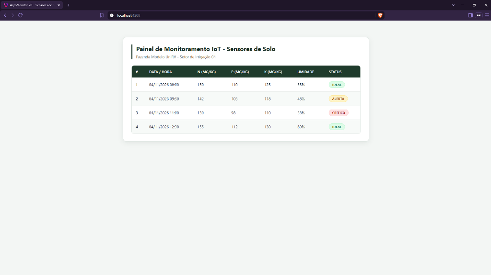

# Agro Sensor Web — Monitoramento IoT de Sensores de Solo

Projeto Angular desenvolvido para a disciplina **Prática de Laboratório — Desenvolvimento Web** (*Frameworks Front-End e Fundamentos do Angular* — UniRV), com foco na criação de uma SPA tipada em TypeScript para visualização de leituras físico-químicas de solo (Nitrogênio, Fósforo, Potássio, Umidade e Data/Hora).

## Identificação do Aluno

- **Nome completo:** Guilherme Henrique Ferreira Silva
- **Matrícula UniRV:** 24107SFT029
- **Professor:** Me. Sergio Souza Novak

## Tecnologias Utilizadas

- Angular (`@angular/cli` 22.2.7 / `@angular/core` 22.2.0)
- TypeScript
- HTML5 e CSS3
- Vitest (testes unitários)

## Instalação e Execução

1. Instale as dependências do projeto:

```bash
npm install
```

2. Inicie o servidor de desenvolvimento:

```bash
ng serve
```

> Caso não tenha a Angular CLI instalada globalmente, utilize `npx ng serve` ou `npm start`.

3. Acesse no navegador:

```text
http://localhost:4200
```

## Testes e Build

- Executar os testes unitários:

```bash
npm test
```

- Gerar build de produção:

```bash
npm run build
```

## Captura de Tela

Tabela de leituras de sensores renderizada em `http://localhost:4200`:


